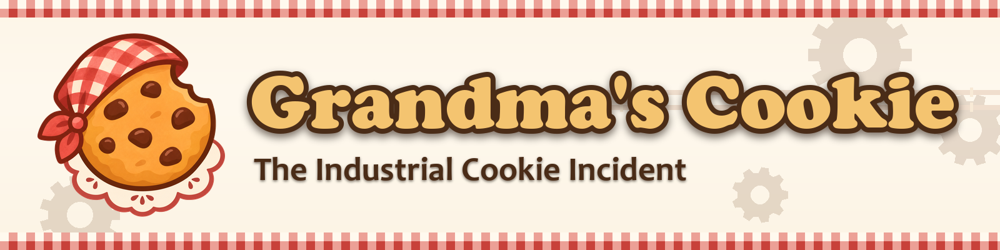
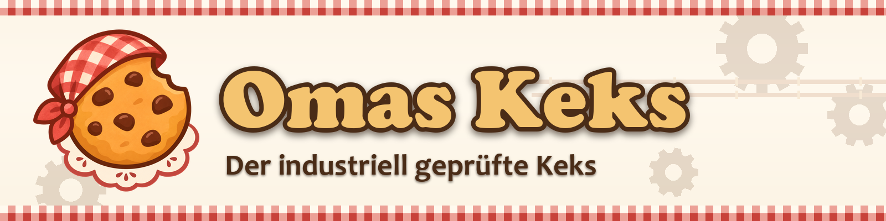

  

  **Minecraft 1.21.1** · **NeoForge** · **English & Deutsch** · **Solo & co-op**

  *She only wants one cookie. You will need a factory.*

  [Deutsch](#deutsch--omas-keks) · [Wiki](wiki-source/Home.md) · [License](LICENSE)

## The story

Grandma would like a cookie with her coffee. *Her* cookie, the one the village fair disqualified in 1987 because of
"missing certificates". This time it will have every certificate there is: certified flour, tempered chocolate,
isotopically pure sugar, quantum vanilla, sealed paperwork from Inspector Crumble's Cookie Authority, and a final
baking licence. You start in Grandma's cozy kitchen. You end with a factory that smokes all the way to the horizon,
a reactor, a rift and a pile of stamped case files. Then you hand over **THE COOKIE**. Personally.

## What is in the pack

- **574 quests in 32 chapters**, all in English and German: 16 main chapters from *The Request* to *Grandma's Verdict*,
  and 16 optional courses (Create basics, rail logistics, the ME course, Grandma's cooking school, her garden,
  storage, power plants and more). The main line never skips a step: every item a quest asks for can be made.
- **A real technical journey:** Create and its add-ons, Modern Industrialization and Extended Industrialization,
  QNet energy, Applied Energistics 2 with ExtendedAE and MEGA Cells, PneumaticCraft: Repressurized, Immersive
  Engineering, Powah and Integrated Dynamics, tied together into one cookie production chain.
- **Pipster is the conduit system.** The author's logistics mod carries items and fluids through the quest line;
  Modern Industrialization's own item and fluid pipes are locked so the network stays a puzzle.
- **Grandma is a real character:** her own animated model, a stooped little lady with a walking stick and a plate of
  cookies, a recorded voice in English and German, dialogue that follows your progress. She cannot be hurt and
  monsters leave her alone. Every time you join the world you are back in her kitchen; your factory stays where it
  is, and `/oma work return` takes you back to work.
- **Her cottage:** timber frame, red roof, a fireplace with a real fire and a kitchen full of Macaw's furniture.
  Somewhere in there is a drawer that has been stuck since 1987.
- **Paperwork as gameplay:** chapter certificates, case files and licences are real written books you collect, sign and
  combine. The final cookie needs all of them.
- **Fair play:** settings that change gameplay are locked for players without operator rights, also in singleplayer
  worlds without cheats; opening a world to LAN does not switch cheats on. The map has no cave view and no monster
  radar.
- **Comfort:** JEI, Jade, Mouse Tweaks, Crafting Tweaks, Controlling and Searchables, Xaero's Minimap and World Map,
  Traveler's Backpack, FTB Ultimine, Storage Drawers, Functional Storage and Building Gadgets. A letter from Grandma
  explains the first steps and shows your actual key bindings.
- **Looks:** original item textures (the finished cookie shimmers in rainbow colours), a custom title screen, Iris and
  Sodium with shaders **off by default**.
- **Truly bilingual:** besides the pack's own texts, almost 13,000 missing German translations for the included mods.
- **Together:** FTB Teams with shared quest progress; Grandma accepts exactly one cookie per team. A separate
  dedicated server pack is part of the release; singleplayer is the complete game.
- **An ending:** credits roll after Grandma tastes the cookie.

## Status

| Part | State |
|---|---|
| Quests (574 / 32 chapters, DE/EN) | Built and loading in game; main chapters play-tested by the author |
| Recipes, cookie chain, certificates | Built (KubeJS); verified on a dedicated server |
| Grandma, cottage, rejoin flow, credits | Built in the companion mod `oma_core`; verified on a dedicated server |
| Dedicated server | Boots with the full mod set; setup scripts in [`server/`](server/README.md) |
| Public release | [Curseforge](https://www.curseforge.com/minecraft/modpacks/grandmas-cookie/) |

## Links

- Player guide: [Wiki](wiki-source/Home.md) (source pages; the GitHub Wiki is filled from them)
- [Credits and licences](THIRD_PARTY_LICENSES.md) · [Pipster on Modrinth](https://modrinth.com/mod/pipster)

---

## Deutsch – Omas Keks

  

**Oma möchte einen Keks zum Kaffee.** *Ihren* Keks, den die Keksbehörde 1987 wegen „fehlender Zertifikate“ vom
Dorffest geworfen hat. Diesmal bekommt er jedes Zertifikat, das es gibt: zertifiziertes Mehl, temperierte Schokolade,
isotopenreinen Zucker, Quanten-Vanille, versiegelte Akten von Inspektor Streusel und eine endgültige Backlizenz. Du
fängst in Omas gemütlicher Küche an und endest mit einer Fabrik bis zum Horizont. Dann überreichst du **DEN KEKS**.
Persönlich.

- **574 Quests in 32 Kapiteln** auf Deutsch und Englisch: 16 Hauptkapitel und 16 freiwillige Lehrgänge.
- **Technik:** Create mit Add-ons, Modern Industrialization, QNet, AE2, PneumaticCraft, Immersive Engineering, Powah,
  Integrated Dynamics und **Pipster** als Rohrsystem.
- **Oma:** eigenes Modell, eigene Stimme (Deutsch und Englisch), unverwundbar, von Monstern verschont; jeder Login
  bringt dich zurück in ihre Küche. Ihr Häuschen ist mit Macaw's-Möbeln eingerichtet, und irgendwo klemmt eine
  Schublade.
- **Fair Play** auch im Einzelspieler, **Komfort-Mods**, **Shader optional und standardmäßig aus**, fast 13 000
  zusätzliche deutsche Übersetzungen für die Mods, Teams mit gemeinsamem Fortschritt, eigener Serverpaket-Download
  und ein Abspann nach der Keksübergabe.

**Stand:** Frühe Version 0.1.0 vollständig spielbar

---

**License / Lizenz:** MIT for the original project content (code, texts, translations, original pictures). Mods,
Minecraft, the voice recordings and other third-party content keep their own licences, see
[`THIRD_PARTY_LICENSES.md`](THIRD_PARTY_LICENSES.md).
